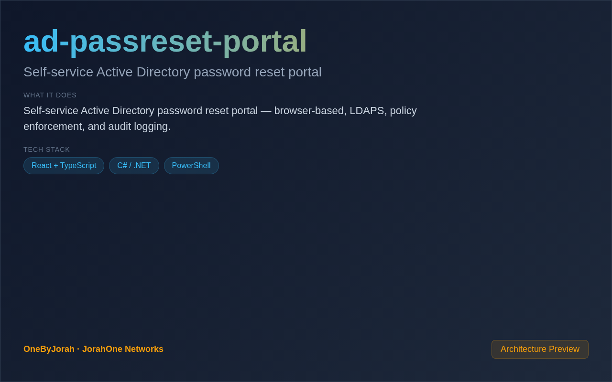

<div align="center">


# ad-passreset-portal

Self-service Active Directory password reset portal


</div>

---

<p align="center">
  
</p>

<br>

---

## Features

- **Self-Service Reset** — Employees change their own password without helpdesk.
- **Policy Enforcement** — Enforces AD password policies (complexity, history, age).
- **LDAPS Support** — Secure LDAP connections to Active Directory.
- **Admin Console** — Manage users, OUs, and portal settings.
- **Audit Logging** — Track all password reset attempts and outcomes.
- **Email Notifications** — Alert admins of failed attempts.
- **Docker Support** — Easy deployment with Docker.
- **Responsive Design** — Works on desktop and mobile devices.

## Quick Start

### Docker (Recommended)

```bash
git clone https://github.com/OneByJorah/ad-passreset-portal.git
cd ad-passreset-portal

cp .env.example .env  # Configure AD settings
docker compose up -d
```

Open **http://localhost:8080** in your browser.

By default the container boots with the debug password provider so you can try the
portal without an Active Directory. For a real deployment set in `.env`:
`ASPNETCORE_ENVIRONMENT=Production`, `WEB_DEBUG_PROVIDER=false`,
`AD_PROVIDER_MODE=Ldap`, and fill in the `AD_*` and `SMTP_*` values. TLS should be
terminated by a reverse proxy in front of the container (it serves plain HTTP on 8080).

### Manual Installation (Windows / IIS)

```bash
dotnet restore src/PassReset.sln
dotnet build src/PassReset.sln
# IIS deployment scripts and Pester test suites live in deploy/
```

## Environment Variables

Docker variables (set in `.env`, see `.env.example`; each maps to the corresponding
`__`-nested ASP.NET configuration key):

| Variable | Default | Description |
|----------|---------|-------------|
| `PORT` | `8080` | Host port bound to 127.0.0.1:8080 |
| `ASPNETCORE_ENVIRONMENT` | `Development` | Use `Production` for real deployments |
| `WEB_DEBUG_PROVIDER` | `true` | `false` to use the real AD provider |
| `AD_PROVIDER_MODE` | `Auto` | `Auto`, `Ldap`, or `Windows` |
| `AD_LDAP_SERVER` | — | Active Directory server hostname |
| `AD_LDAP_PORT` | `636` | LDAP port (636 for LDAPS) |
| `AD_LDAP_USE_SSL` | `true` | Use LDAPS |
| `AD_BASE_DN` | — | Base DN for user searches |
| `AD_SERVICE_ACCOUNT_DN` | — | Service account DN used by the LDAP provider |
| `AD_SERVICE_PASSWORD` | — | Service account password |
| `SMTP_HOST` | — | SMTP relay host |
| `SMTP_PORT` | `587` | SMTP relay port |
| `SMTP_FROM` | — | From address for notifications |
| `HEALTH_DISABLE_AD_PROBE` | `true` | Skip AD connectivity probe in /api/health |
| `HEALTH_DISABLE_SMTP_PROBE` | `true` | Skip SMTP probe in /api/health |

Application settings (IIS/manual installs) live in
`src/PassReset.Web/appsettings.json`, validated against
`src/PassReset.Web/appsettings.schema.json`; the production template is
`src/PassReset.Web/appsettings.Production.template.json`.

## Configuration

### Active Directory Settings

1. Create a service account in AD with "Reset Password" permissions
2. Enable LDAPS on your domain controller
3. Add the service account credentials to `.env`

### Password Policies

The portal enforces these AD policies:
- Minimum length (configurable)
- Complexity requirements (uppercase, lowercase, numbers, symbols)
- Password history (prevents reuse)
- Maximum age (if configured in AD)

## Architecture

```
Browser ──HTTPS──▶ ASP.NET Core ──LDAPS──▶ Active Directory
                        │
                        ├──▶ Audit Logger
                        ├──▶ Email Notifier
                        └──▶ Admin Console
```

## Project Structure

```
ad-passreset-portal/
├── src/
│   ├── PassReset.Web/            # ASP.NET Core host (API + Razor admin + React SPA)
│   │   ├── Controllers/          # HealthController, PasswordController
│   │   ├── ClientApp/            # React (Vite) SPA → builds to wwwroot/
│   │   └── appsettings.json      # Configuration (schema-validated)
│   ├── PassReset.Common/         # Shared policy/local checkers
│   ├── PassReset.PasswordProvider/       # Windows AD provider (System.DirectoryServices)
│   └── PassReset.PasswordProvider.Ldap/  # Cross-platform LDAPS provider
├── deploy/                       # IIS install/uninstall scripts + Pester tests
└── docs/                         # Brand assets and guides
```

## Admin Console

Access the admin console at `/admin`:

| Feature | Description |
|---------|-------------|
| User Management | View and manage portal users |
| Audit Logs | Review all password reset attempts |
| Policy Settings | Configure password requirements |
| Email Settings | Configure notification recipients |

## Contributing

Contributions are welcome. Please see [CONTRIBUTING.md](CONTRIBUTING.md) for guidelines and [CODE_OF_CONDUCT.md](CODE_OF_CONDUCT.md) for community standards.

## Security

For security concerns, see [SECURITY.md](SECURITY.md). Please report vulnerabilities to **info@jorahone.com** — do not use public issues.

## License

MIT © Jhonattan L. Jimenez

---

## 🤝 Contributing

See [CONTRIBUTING.md](CONTRIBUTING.md). All contributions follow the [Code of Conduct](CODE_OF_CONDUCT.md).

## 🔒 Security

Found a vulnerability? Please follow our [Security Policy](SECURITY.md) and report privately to `security@jorahone.com`.

## 📄 License

[Other](LICENSE) © Jhonattan L. Jimenez (OneByJorah)

---

<p align="center">Built with 🌴 by <a href="https://github.com/OneByJorah">OneByJorah</a> · <a href="https://jorahone.com">jorahone.com</a></p>
